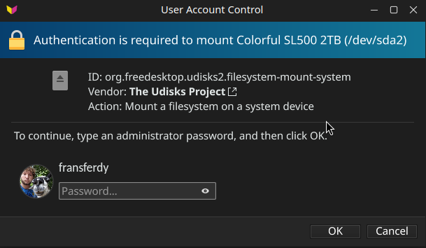

# Capy OS UAC Polkit Agent 



Capy OS UAC Polkit Agent is an alternative frontend designed to look like something between the User Account Control dialog of Windows 7 and Windows 10.

It is a fork of https://github.com/aeroshell-desktop/uac-polkit-agent

## Building
```bash
cmake -B build -G Ninja -DCMAKE_INSTALL_PREFIX=/usr
cmake --build build
```

## Installing

```bash
sudo cmake --install build
```

Executable goes to: /usr/lib/libexec/uac-polkit-agent

Add to ~/.config/autostart

```ini
[Desktop Entry]
Exec=/usr/lib/libexec/uac-polkit-agent
Name=uac-polkit-agent
Type=Application
Version=1.0
```
